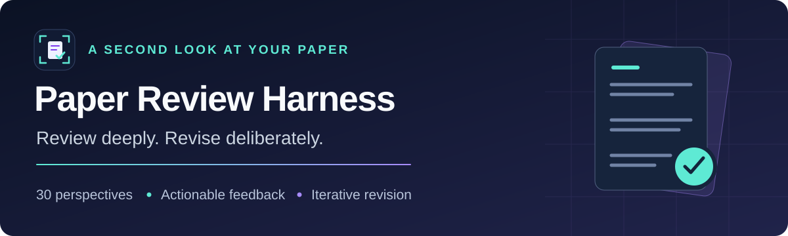

<p align="center">
  
</p>

<p align="center">
  
  
  
  
</p>

<p align="center">
  <a href="#quick-start">Quick start</a> ·
  <a href="#choose-your-panel">Panels</a> ·
  <a href="#the-revision-loop">Revision loop</a> ·
  <a href="REVIEW_PAPER.md">Agent entry point</a> ·
  <a href="01_sources/README.md">Research behind the harness</a>
</p>

Find the weak points in your paper before submission. **CVPR Review Harness** turns a draft into independent simulated reviews, section-level scores, and a concrete revision plan. Sixteen reviewer personas bring different expertise, priorities, and reading habits—from the subfield expert to the rushed senior reviewer.

Every criticism can become an actionable thread: revise the draft, explain the change, and have a fresh instance of the reviewer check whether the evidence resolves the concern.

> This is an independent research tool for simulated feedback. It is not affiliated with CVPR, and its scores are not acceptance predictions.

## What you get

| Capability | What it gives you |
|---|---|
| **Independent perspectives** | Separate reviewer jobs with their own persona, reading view, and output folder. |
| **Scores with context** | Overall recommendations, first impressions, and scores for up to 13 paper sections. |
| **Actionable feedback** | Located weaknesses, suggested fixes, and explicit criteria for satisfying each reviewer. |
| **Iterative revision** | An answer sheet, point-by-point follow-up reviews, and a running history of open issues. |
| **Progress checks** | Held-out reviewers, repeat reviews of an unchanged draft, fix checks, and blind comparisons. |
| **Inspectable artifacts** | Frozen paper snapshots, Markdown reports, JSON records, and prompt hashes. |

The Python CLI prepares review jobs and processes their outputs. **An agent environment runs the reviewers and writer**; the CLI does not call a model API or launch agents itself. Use an environment that can read local files and create independent agent instances, such as Claude Code or Codex with suitable agent support.

## Quick start

### 1. Set up the harness

You need **Python 3.9+**, **PyMuPDF**, a paper PDF, and your agent environment. A supplement and LaTeX sources are optional.

```sh
git clone https://github.com/Optimizer077/cvpr-review-harness.git
cd cvpr-review-harness
python -m pip install pymupdf
python 06_scripts/hx.py personas
```

These examples use `python`; use `python3` if that is your Python command. Clone access is required while the repository is private.

### 2. Create a review session

```sh
python 06_scripts/hx.py new --paper "path/to/main.pdf" --name mypaper --panel realistic --mode both
```

The command freezes the draft, selects a panel, and prints the session path and reviewer launch instructions. Add `--supp "path/to/supplement.pdf"` for supplementary material, `--tex "path/to/latex"` for the writer's source directory, or `--domain inr_neural_fields` for the included neural-fields domain pack.

### 3. Run independent reviewers

Give **each printed prompt to a fresh agent**, using exactly:

```text
Read <prompt path> and follow it exactly. Write only the files it names.
```

Keep reviewer contexts separate. For an agent-led walkthrough, start with [REVIEW_PAPER.md](REVIEW_PAPER.md).

### 4. Validate and read the results

Replace `<session>` below with the **exact session path printed by `new`**, or its full folder name under `sessions/`. The short `--name` alone is not the session identifier.

```sh
python 06_scripts/hx.py validate "<session>"
python 06_scripts/hx.py aggregate "<session>"
```

Every job should validate before you aggregate. Open `round_01/SCORES.md` for the scorecard and `round_01/FEEDBACK.md` for the prioritized revision list. If a job fails validation, rerun that job with a fresh agent.

## Choose your panel

| Panel | Reviewers | Best used for |
|---|---|---|
| `realistic` | 3, drawn from expertise pools | A varied first assessment. |
| `realistic4` | 4, drawn from expertise pools | One more perspective on the draft. |
| `quick` | R09 · R03 · R08 | An initial pass across first impressions, expertise, and accessibility. |
| `stress` | R02 · R03 · R05 · R11 | Novelty, technical rigor, and difficult objections. |
| `writing` | R07 · R08 · R09 · R12 | Clarity, narrative, and how the contribution comes across. |
| `core` | R01 · R02 · R03 · R05 · R07 · R09 · R11 | Broad coverage with seven perspectives. |
| `gauntlet` | All 16 personas | A comprehensive pass before submission. |

Use `--seed 1` to change a drawn panel or `--reviewers R03,R11` to select specific reviewers. The panel stays fixed across revisions within a session.

| Mode | Behavior |
|---|---|
| `full` **(CLI default)** | Whole-paper reviews, with section scores for the sections each reviewer reads. |
| `sections` | Dedicated section-review jobs, without overall recommendations. |
| `both` | Whole-paper reviews plus the dedicated section panel; used in the quick start above. |

For a focused pass, add `--sections abstract,introduction`. The section panel uses its own [section-to-persona mapping](04_panels/section_panel.json).

<details>
<summary><strong>Meet all 16 reviewer personas</strong></summary>

| ID | Persona | Primary focus |
|---|---|---|
| R01 | Leaderboard reviewer | Baselines, datasets, and the main results table. |
| R02 | Novelty skeptic | Closest prior work and what is actually new. |
| R03 | Subfield expert | Technical details and field-specific expectations. |
| R04 | Theory checker | Assumptions, proofs, and the role of theory. |
| R05 | Rigor methodologist | Fair comparisons, seeds, tuning, and ablations. |
| R06 | Efficiency pragmatist | Runtime, memory, scaling, and practical cost. |
| R07 | Clarity editor | Definitions, structure, figures, and readability. |
| R08 | Adjacent generalist | Intuition and relevance beyond the immediate subfield. |
| R09 | Busy senior | Opening pages, figures, and first impressions. |
| R10 | Junior checklist | Completeness, implementation details, and expected comparisons. |
| R11 | Hostile Reviewer 2 | Ambiguous claims and weaknesses a skeptical reader could press. |
| R12 | Champion | Clear contributions and evidence a supporter can defend. |
| R13 | Reproducibility auditor | Missing settings and results that can be checked. |
| R14 | Competing lab | Attribution and comparison with the closest research line. |
| R15 | LLM-assisted reviewer | Generic objections and surface-level reading patterns. |
| R16 | Misassigned outsider | Whether the paper makes sense outside its niche. |

Persona definitions live in [03_personas/](03_personas/); their supporting research lives in [01_sources/](01_sources/).

</details>

## The revision loop

**Review → prioritize → revise → check the answers → review again.**

1. **Prepare the writer.** After aggregation, generate the writer brief and answer sheet:

   ```sh
   python 06_scripts/hx.py stage "<session>" writer
   ```

2. **Address every open point.** The writer fills in `writer/RESPONSE.md`, edits the paper sources, rebuilds the PDF, and records changes. Each answer should identify the evidence or exact change that resolves the concern.

3. **Create the next round.** Supply the revised PDF and, if applicable, the revised supplement:

   ```sh
   python 06_scripts/hx.py round "<session>" --paper "path/to/revised-main.pdf"
   ```

4. **Run the printed prompts.** In the default `dialogue` loop, fresh instances of the same personas review their own feedback threads and mark each point satisfied, partly satisfied, or not satisfied. Held-out jobs receive fresh reviews of the draft.

5. **Validate and aggregate again.** Read the updated `FEEDBACK.md` and session-wide `PROGRESS.md`, then start the next revision.

**Continue for as many rounds as the task needs.** There is no fixed round cap or automatic stop after a score plateau. Keep working on actionable feedback within your requested scope; report blockers when further progress needs new evidence or input.

Use the session's `AUTHOR_CONSTRAINTS.md` to record project requirements, permitted experiments, and writing preferences. The writer reads this file; reviewers do not.

### Check whether a revision helped

- **Held-out reviewers:** add `--heldout R02,R11` when creating a session. Their reviews stay separate from the writer's feedback. Use a different model from the writer for held-out reviews and blind judging.
- **Repeatability:** `python 06_scripts/hx.py retest "<session>"` prepares fresh reviews of an unchanged draft. Run those prompts, validate, and aggregate to estimate score variability.
- **Fresh reviews:** choose `--loop fresh` at session creation to use independent full reviews instead of feedback dialogue on later rounds.
- **Fix checks and blind comparison:** after a revised round, use the commands below and run their printed prompts to check resolved weaknesses and compare changed sections.

```sh
python 06_scripts/hx.py stage "<session>" fixcheck
python 06_scripts/hx.py stage "<session>" pairwise
```

Read scores alongside the underlying evidence. Language-model reviewers can share blind spots, and small score changes can be noise. [AGENTS.md](AGENTS.md) defines the independence and revision-acceptance rules.

## Where to find everything

| Artifact | Purpose |
|---|---|
| `round_NN/SCORES.md` · `SCORES.json` | Overall and section scores, reviewer comparisons, and decisive weaknesses. |
| `round_NN/FEEDBACK.md` · `FEEDBACK.json` | Open issues, suggested fixes, and satisfaction criteria. |
| `round_NN/reviews/<job>/` | Initial review, structured scores, and an explanatory debrief. |
| `round_NN/satisfaction/<job>/` | Follow-up replies and point-by-point satisfaction judgments. |
| `round_NN/writer/` | Answer sheet, change log, and experiment requests. |
| `round_NN/snapshot/` | Frozen PDFs, extracted text, and section views for that round. |
| `PROGRESS.md` | Session-wide score history and repeatability information. |

<details>
<summary><strong>Repository map and CLI reference</strong></summary>

```text
01_sources/       Research behind the review design
02_protocol/      Review forms, scoring rubrics, and writer rules
03_personas/      Sixteen persona cards and their registry
04_panels/        Whole-paper and section panel definitions
05_templates/     Output schemas and author constraints
06_scripts/       Python CLI, harness library, and smoke test
07_domain_packs/  Additional subfield knowledge
assets/           README logo and banner
sessions/         Local paper snapshots and review campaigns
```

| Command | Purpose |
|---|---|
| `personas` | List the available reviewer personas. |
| `new` | Create a session and prepare the first review prompts. |
| `status <session>` | Inspect jobs, output files, and launch instructions. |
| `validate <session>` | Check review outputs against the expected schema. |
| `aggregate <session>` | Generate scores, feedback, and progress reports. |
| `stage <session> writer` | Prepare the writer brief and response scaffold. |
| `round <session> --paper <pdf>` | Create the next round from a revised draft. |
| `retest <session>` | Prepare fresh reviews of an unchanged snapshot. |
| `stage <session> fixcheck` | Prepare a check of earlier weaknesses. |
| `stage <session> pairwise` | Prepare a blind comparison of changed sections. |

Use `python 06_scripts/hx.py <command> --help` for command-specific options. Set the venue, prior-work cutoff, and rating profile at session creation with `--venue`, `--cutoff`, and `--scale` as appropriate for your project.

</details>

## Development and sharing

Run the mechanics check after changes to scripts, personas, panels, or protocol:

```sh
python 06_scripts/hx.py personas
python 06_scripts/smoke_test.py
```

The smoke test uses a synthetic PDF and simulated review records; it makes no model calls.

Sessions contain paper snapshots and reviews and are excluded from Git by default. To package the reusable harness without sessions, caches, or build notes:

```sh
python 06_scripts/export_public.py
```

The exporter writes a folder and ZIP under `release/` and scans exported text for identifying strings. Model execution and data handling depend on the agent environment you choose.
