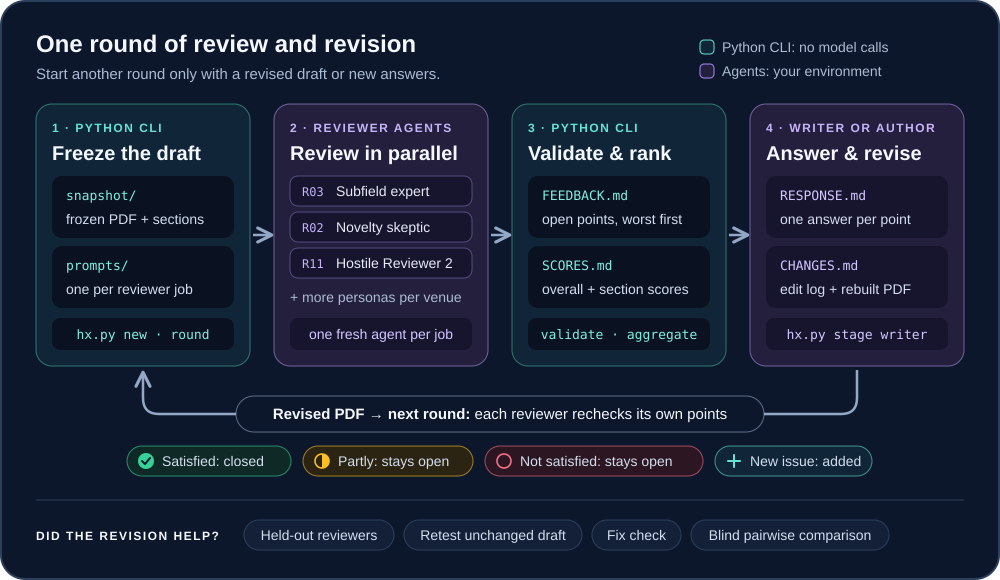

<p align="center">
  
</p>

<p align="center">
  
  
  
  
</p>

<p align="center">
  <a href="#quick-start">Quick start</a> ·
  <a href="#how-it-works">How it works</a> ·
  <a href="#choose-your-panel">Panels</a> ·
  <a href="#the-revision-loop">Revision loop</a> ·
  <a href="#reading-the-results">Results</a> ·
  <a href="#troubleshooting">Troubleshooting</a>
</p>

## Give your paper a demanding first audience

**Find the weak points in your paper. Revise them. Check whether the changes helped.** CVPR Review Harness turns a PDF into independent simulated reviews, section scores, and a prioritized revision plan. Sixteen personas bring different expertise and reading habits; every open criticism can be tracked through later drafts.

**Start here:** [Run a review with an agent](REVIEW_PAPER.md) · [Read the operating rules](AGENTS.md) · [Explore the supporting research](01_sources/README.md)

> This is an independent research tool for simulated feedback. It is not affiliated with CVPR, and its scores are not acceptance predictions.

## How it works

<p align="center">
  <picture>
    <source media="(max-width: 640px)" srcset="assets/workflow-mobile.svg">
    
  </picture>
</p>

The **Python CLI** prepares snapshots and prompts, validates outputs, and builds reports. Your **agent environment** runs each reviewer in a separate context; a writer agent or the author revises the paper. The CLI does not launch agents or call a model API.

The figure shows the default `dialogue` loop. [Open the full-size figure](assets/workflow.svg) or its [vertical version](assets/workflow-mobile.svg).

## Quick start

### 1. Set up the harness

You need **Python 3.9+**, **PyMuPDF**, a paper PDF with extractable text, and an agent environment. A supplement is optional. Supply the paper's source directory if you want a writer agent to revise it.

```sh
git clone https://github.com/Optimizer077/cvpr-review-harness.git
cd cvpr-review-harness
python -m pip install pymupdf
python 06_scripts/hx.py personas
```

These examples use `python`; use `python3` if that is your Python command.

<details>
<summary>Optional: install in a virtual environment</summary>

Before installing PyMuPDF, create and activate an environment:

**PowerShell**

```powershell
python -m venv ../cvpr-review-env
../cvpr-review-env/Scripts/Activate.ps1
python -m pip install pymupdf
```

**macOS / Linux**

```sh
python3 -m venv ../cvpr-review-env
source ../cvpr-review-env/bin/activate
python -m pip install pymupdf
```

The environment sits beside the repository so it is not included in commits or exports.

</details>

### 2. Create a review session

```sh
python 06_scripts/hx.py new --paper "path/to/main.pdf" --name mypaper
```

Replace `path/to/main.pdf` with your PDF path. This uses the defaults: **three reviewers**, the `realistic` panel, and `full` review mode. The command prints a session path such as `sessions/YYYY-MM-DD_mypaper` and one launch instruction per reviewer.

For dedicated section-review jobs as well, add `--mode both`. This increases the number of jobs beyond the whole-paper panel.

| Optional input | Add to the command |
|---|---|
| Supplementary PDF | `--supp "path/to/supplement.pdf"` |
| Paper source directory | `--tex "path/to/latex"` |
| Neural-fields domain knowledge | `--domain inr_neural_fields` |
| Separate evaluation reviewers | `--heldout R02,R11` |

For other subfields, omit `--domain` or add an appropriate [domain pack](07_domain_packs/README.md).

### 3. Run independent reviewers

Give **each printed prompt to a fresh agent**, using exactly:

```text
Read <prompt path> and follow it exactly. Write only the files it names.
```

Run the printed instructions in your agent environment, with separate contexts for each reviewer. Review files appear only after those agents finish. [REVIEW_PAPER.md](REVIEW_PAPER.md) gives the orchestrating agent the full procedure.

### 4. Validate and read the results

Replace `<session>` below with the **exact session path printed by `new`**, or its full folder name under `sessions/`. The short `--name` alone is not the session identifier.

```sh
python 06_scripts/hx.py validate "<session>"
python 06_scripts/hx.py aggregate "<session>"
```

**Run `aggregate` only after every job validates.** Then open these files inside the printed session folder:

1. **`round_01/FEEDBACK.md`** — what to fix first, why, and what would resolve it.
2. **`round_01/SCORES.md`** — overall recommendations and section-level weaknesses.
3. **`round_01/reviews/<job>/debrief.md`** — what triggered a reviewer's reaction and the smallest useful change.

If a job fails validation, rerun that job with a fresh agent. Use `python 06_scripts/hx.py status "<session>"` to inspect missing files and recover launch instructions.

## Choose your panel

| Panel | Reviewers | Best used for |
|---|---|---|
| `realistic` | 3, drawn from expertise pools | A varied first assessment. |
| `realistic4` | 4, drawn from expertise pools | One more perspective on the draft. |
| `quick` | R09 · R03 · R08 | An initial pass across first impressions, expertise, and accessibility. |
| `stress` | R02 · R03 · R05 · R11 | Novelty, technical rigor, and difficult objections. |
| `writing` | R07 · R08 · R09 · R12 | Clarity, narrative, and how the contribution comes across. |
| `core` | R01 · R02 · R03 · R05 · R07 · R09 · R11 | Broad coverage with seven perspectives. |
| `gauntlet` | All 16 personas | A comprehensive pass before submission. |

**A practical starting point:** use `realistic` for a broad first review, `writing` to focus on presentation, or `stress` to probe difficult objections. Use `--mode full` when you want only whole-paper jobs; add `--mode both` when you also want dedicated section coverage.

Use `--seed 1` to change a drawn panel or `--reviewers R03,R11` to select specific reviewers. The panel stays fixed across revisions within a session.

| Mode | Behavior |
|---|---|
| `full` **(CLI default)** | Whole-paper reviews, with section scores for the sections each reviewer reads. |
| `sections` | Dedicated section-review jobs, without overall recommendations. |
| `both` | Whole-paper reviews plus dedicated jobs from the section panel. |

For a focused pass, add `--sections abstract,introduction`. The section panel uses its own [section-to-persona mapping](04_panels/section_panel.json).

<details>
<summary><strong>Meet all 16 reviewer personas</strong></summary>

| ID | Persona | Primary focus |
|---|---|---|
| R01 | Leaderboard reviewer | Baselines, datasets, and the main results table. |
| R02 | Novelty skeptic | Closest prior work and what is actually new. |
| R03 | Subfield expert | Technical details and field-specific expectations. |
| R04 | Theory checker | Assumptions, proofs, and the role of theory. |
| R05 | Rigor methodologist | Fair comparisons, seeds, tuning, and ablations. |
| R06 | Efficiency pragmatist | Runtime, memory, scaling, and practical cost. |
| R07 | Clarity editor | Definitions, structure, figures, and readability. |
| R08 | Adjacent generalist | Intuition and relevance beyond the immediate subfield. |
| R09 | Busy senior | Opening pages, figures, and first impressions. |
| R10 | Junior checklist | Completeness, implementation details, and expected comparisons. |
| R11 | Hostile Reviewer 2 | Ambiguous claims and weaknesses a skeptical reader could press. |
| R12 | Champion | Clear contributions and evidence a supporter can defend. |
| R13 | Reproducibility auditor | Missing settings and results that can be checked. |
| R14 | Competing lab | Attribution and comparison with the closest research line. |
| R15 | LLM-assisted reviewer | Generic objections and surface-level reading patterns. |
| R16 | Misassigned outsider | Whether the paper makes sense outside its niche. |

Persona definitions live in [03_personas/](03_personas/); their supporting research lives in [01_sources/](01_sources/).

</details>

## The revision loop

**Review → prioritize → revise → check the answers → review again.**

1. **Prepare the writer.** Record your source directory with `--tex "path/to/latex"` when creating the session, or set `tex_dir` in its `SESSION.json` to the absolute source-directory path before starting the writer. Then generate the brief and answer sheet:

   ```sh
   python 06_scripts/hx.py stage "<session>" writer
   ```

2. **Address every open point.** Run the printed writer prompt with a writer agent, or follow it yourself. Fill in `writer/RESPONSE.md`, edit the paper sources, rebuild the PDF, and record changes. Each answer should identify the evidence or exact change that resolves the concern. The `stage` command only prepares the brief and answer sheet.

3. **Create the next round.** Supply the revised PDF and, if applicable, the revised supplement:

   ```sh
   python 06_scripts/hx.py round "<session>" --paper "path/to/revised-main.pdf" --supp "path/to/revised-supplement.pdf"
   ```

   Omit `--supp` if there is no supplement. Pass it again when there is one; a revised round does not automatically reuse the previous supplement.

4. **Run the printed prompts.** In the default `dialogue` loop, fresh instances of the same personas check their own feedback threads against the revised draft. A point can be `satisfied`, `partly`, or `not_satisfied`; new issues can be raised. Held-out reviewers assess the draft from scratch.

5. **Validate and aggregate again.** Read the updated `FEEDBACK.md` and session-wide `PROGRESS.md`, then start the next revision.

**Continue for as many rounds as the task needs.** There is no fixed round cap or automatic stop after a score plateau. Keep working on actionable feedback within your requested scope; report blockers when further progress needs new evidence or input.

Use the session's `AUTHOR_CONSTRAINTS.md` to record project requirements, permitted experiments, and writing preferences. The writer reads this file; reviewers do not.

### Check whether a revision helped

- **Held-out reviewers:** add `--heldout R02,R11` when creating a session. Their reviews stay separate from the writer's feedback. Use a different model from the writer for held-out reviews and blind judging.
- **Repeatability:** `python 06_scripts/hx.py retest "<session>"` prepares fresh reviews of an unchanged draft. Run those prompts, validate, and aggregate to estimate score variability.
- **Fresh reviews:** choose `--loop fresh` at session creation to repeat the configured review jobs from scratch on later rounds. Unlike dialogue reviewers, these reviewers do not receive the earlier feedback thread or the writer's answers.
- **Fix checks and blind comparison:** after a revised round, use the commands below and run their printed prompts to check resolved weaknesses and compare changed sections.

```sh
python 06_scripts/hx.py stage "<session>" fixcheck
python 06_scripts/hx.py stage "<session>" pairwise
```

Read scores alongside the underlying evidence. Language-model reviewers can share blind spots, and small score changes can be noise. [AGENTS.md](AGENTS.md) defines the independence and revision-acceptance rules.

## Reading the results

### From criticism to a concrete next step

The feedback format connects each objection to a location and a test for resolution. For example:

> **Illustrative feedback—not a result from an actual paper**
>
> **Where:** Experiments, Table 2<br>
> **Concern:** The runtime comparison omits hardware and batch size.<br>
> **Suggested fix:** Add the measurement setup beside the table.<br>
> **What would satisfy the reviewer:** Enough detail to determine whether the runtime measurements are comparable.

The writer answers the point with a change or an evidence-backed explanation. A fresh instance of that persona then checks the revised paper and records whether the point is satisfied, partly satisfied, or still open.

### Understand the scores

**Read the criticisms before optimizing the numbers.** A higher mean can hide one decisive objection or a weaker section.

| Signal | How to interpret it |
|---|---|
| Overall recommendation | The default harness profile is 1–5: Reject, Weak Reject, Borderline, Weak Accept, Strong Accept. |
| First impression | The recommendation recorded after the initial skim, before the detailed read. |
| Section score | A 1–10 assessment tied to [section rubrics](02_protocol/section_rubrics.md). Each sub-criterion is scored on a separate 1–5 scale. |
| Decisive weakness | A concern the reviewer considers sufficient to block acceptance by itself. |
| Satisfaction status | Whether the revised draft resolves a particular point; unresolved and new points remain in the feedback list. |
| Progress across rounds | Changes in scores, including noise thresholds when repeat reviews are available. |

The headline uses held-out reviewers when present; otherwise it uses feedback reviewers. Section scores are a harness addition. Rating profiles and their source notes live in [scales.json](02_protocol/scales.json).

### Output map

| Artifact | Purpose |
|---|---|
| `round_NN/SCORES.md` · `SCORES.json` | Overall and section scores, reviewer comparisons, and decisive weaknesses. |
| `round_NN/FEEDBACK.md` · `FEEDBACK.json` | Open issues, suggested fixes, and satisfaction criteria. |
| `round_NN/reviews/<job>/` | Initial review, structured scores, and an explanatory debrief. |
| `round_NN/satisfaction/<job>/` | Follow-up replies and point-by-point satisfaction judgments. |
| `round_NN/writer/` | Answer sheet, change log, and experiment requests. |
| `round_NN/snapshot/` | Frozen PDFs, extracted text, and section views for that round. |
| `PROGRESS.md` | Session-wide score history and repeatability information. |

<details>
<summary><strong>Repository map and CLI reference</strong></summary>

```text
01_sources/       Research behind the review design
02_protocol/      Review forms, scoring rubrics, and writer rules
03_personas/      Sixteen persona cards and their registry
04_panels/        Whole-paper and section panel definitions
05_templates/     Output schemas and author constraints
06_scripts/       Python CLI, harness library, and smoke test
07_domain_packs/  Additional subfield knowledge
assets/           README logo, banner, and workflow figure
sessions/         Local paper snapshots and review campaigns
```

| Command | Purpose |
|---|---|
| `personas` | List the available reviewer personas. |
| `new` | Create a session and prepare the first review prompts. |
| `status <session>` | Inspect jobs, output files, and launch instructions. |
| `validate <session>` | Check review outputs against the expected schema. |
| `aggregate <session>` | Generate scores, feedback, and progress reports. |
| `stage <session> writer` | Prepare the writer brief and response scaffold. |
| `round <session> --paper <pdf>` | Create the next round from a revised draft. |
| `retest <session>` | Prepare fresh reviews of an unchanged snapshot. |
| `stage <session> fixcheck` | Prepare a check of earlier weaknesses. |
| `stage <session> pairwise` | Prepare a blind comparison of changed sections. |

Use `python 06_scripts/hx.py <command> --help` for command-specific options. Set the venue, prior-work cutoff, and rating profile at session creation with `--venue`, `--cutoff`, and `--scale` as appropriate for your project.

</details>

## Troubleshooting

| What you see | What to do |
|---|---|
| `No module named fitz` | Install PyMuPDF with the same interpreter: `python -m pip install pymupdf`. |
| `No SESSION.json` | Use the exact printed session path or full date-prefixed folder name, rather than only `mypaper`. |
| Session already exists | Add `--tag second-pass` to create a separate session, or use `round` to revise the existing one. |
| Prompts exist but no reviews | Run the printed reviewer jobs in your agent environment; `new` only prepares them. |
| Validation reports `FAIL` | Inspect the reported errors and rerun the affected job with a fresh agent. |
| Poor or missing extracted text | Inspect `snapshot/` and use a PDF with a usable text layer before starting the review. |
| Small or inconsistent score gains | Use `retest` and inspect the underlying criticisms before treating a change as improvement. |

## Development and sharing

Run the mechanics check after changes to scripts, personas, panels, or protocol:

```sh
python 06_scripts/hx.py personas
python 06_scripts/smoke_test.py
```

The smoke test uses a synthetic PDF and simulated review records; it makes no model calls.

Sessions contain paper snapshots and reviews and are excluded from Git by default. To package the reusable harness without sessions, caches, or build notes:

```sh
python 06_scripts/export_public.py
```

The exporter writes a folder and ZIP under `release/` and scans exported text for identifying strings. Model execution and data handling depend on the agent environment you choose.
